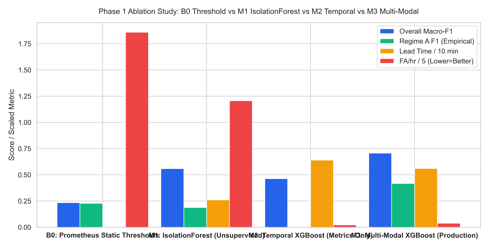
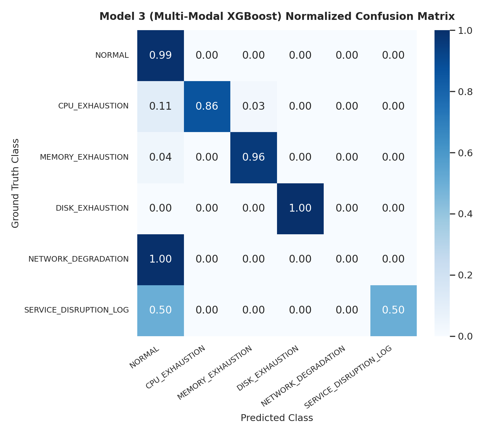
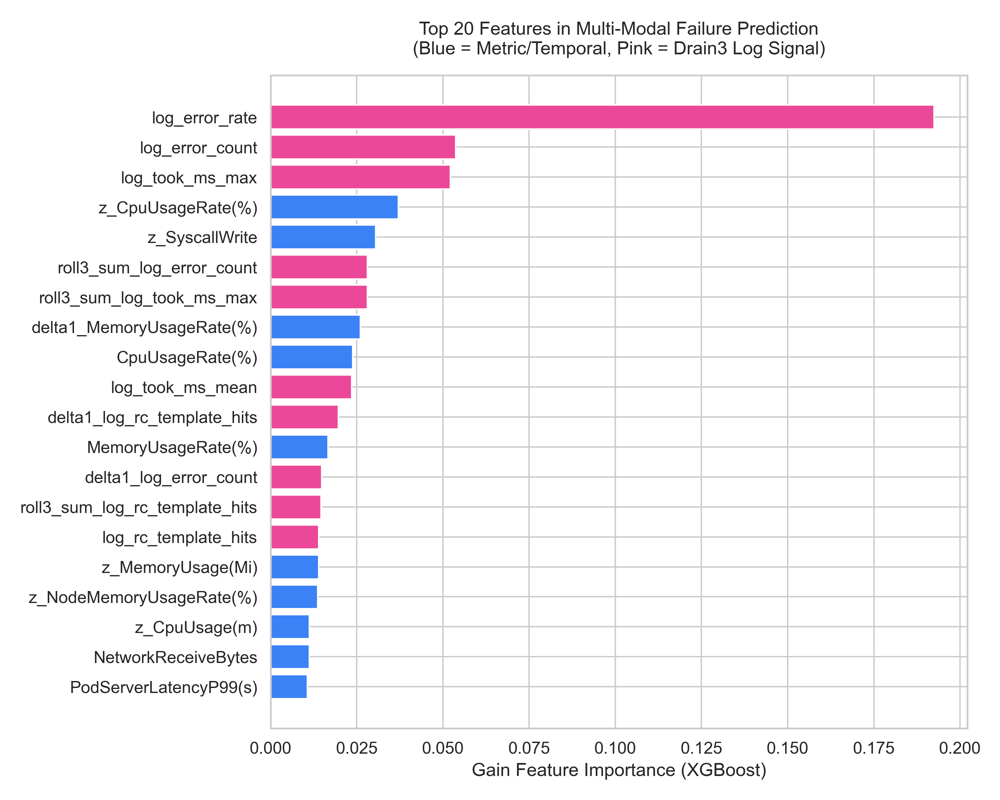

# 🏺 Kintsugi-AI
**Autonomous Multi-Modal Kubernetes Failure Prediction & Closed-Loop LangGraph Remediation System**

> *"Catch the cracks. Verify the fix."*

[](https://opensource.org/licenses/MIT)
[](https://www.python.org/downloads/)
[](https://kintsugi-ai.onrender.com/app/)
[](https://kintsugi-ai.onrender.com/app/slides.html)
[](https://github.com/Akki-74/kintsugi-sre/actions)
[-326CE5.svg?logo=kubernetes&logoColor=white)](https://kubernetes.io/)
[](https://fastapi.tiangolo.com)
[](https://github.com/langchain-ai/langgraph)
[](https://xgboost.readthedocs.io)
[](https://react.dev/)
[](https://www.docker.com)
[-brightgreen.svg)]()

> 🚀 **Live Interactive Command Center (Free Cloud Deployment on Render):**  
> 👉 **[https://kintsugi-ai.onrender.com/app/](https://kintsugi-ai.onrender.com/app/)** *(Zero setup required — interact directly with the 10-microservice topology mesh, live chaos injection, ML & SARIMA benchmark modal, and LangGraph autonomous healing)*
>
> 🖥️ **Interactive Systems Architecture Slide Deck (Fullscreen & Print to PDF):**  
> 👉 **[https://kintsugi-ai.onrender.com/app/slides.html](https://kintsugi-ai.onrender.com/app/slides.html)** *(Local: `http://localhost:8000/app/slides.html` — navigate with `←` / `→` arrow keys to inspect system architecture, ablation tables, and diagnostic plots)*

> **Kintsugi-AI** takes its name from the centuries-old Japanese art of *Kintsugi* (金継ぎ)—mending fractured ceramics with liquid gold lacquer so the repaired vessel emerges stronger, more resilient, and visibly verifiable at every seam.
> 
> Applied to Cloud-Native Site Reliability Engineering, **Kintsugi-AI** unifies a **Fast Brain** (89-Feature Multi-Modal Temporal `XGBClassifier` & Time-to-Exhaustion `XGBRegressor` benchmarked against seasonal `SARIMA`) for sub-second onset detection and gradual horizon forecasting with a **Slow Brain** (Guardrailed 6-Node LangGraph Ambient SRE Agent powered by `qwen/qwen3.8-27b`) that autonomously correlates container logs, enforces **5 deterministic SRE safety guardrails**, executes real cluster mutations via the official Kubernetes Python SDK, and seals the repaired microservice pod with the **✦ Kintsugi Gold Seam**.

---

## 📑 Table of Contents
1. [Benchmark Verification Checkpoint](#-benchmark-verification-checkpoint)
2. [Phase 1 Diagnostic Visualizations](#-phase-1-diagnostic-visualizations)
3. [Phase 1 Deep Dive: Multi-Modal Prediction Engine ("Fast Brain")](#-phase-1-deep-dive-multi-modal-prediction-engine-fast-brain)
   - [Data Engineering & Nezha Timestamp Alignment](#1-data-engineering--nezha-timestamp-alignment)
   - [89-Feature Multi-Modal Engineering Pipeline](#2-89-feature-multi-modal-engineering-pipeline)
   - [6-Class Operational Fault Taxonomy](#3-6-class-operational-fault-taxonomy)
   - [Formal 4-Model Classification Ablation Study](#4-formal-4-model-classification-ablation-study)
   - [Regime B Horizon Study: Classical SARIMA vs. Multi-Modal XGBRegressor](#5-regime-b-horizon-study-classical-sarima-vs-multi-modal-xgbregressor)
4. [Two-Brain System Architecture](#️-two-brain-system-architecture)
5. [4 Standout Architectural Achievements](#-4-standout-architectural-achievements)
6. [Phase 2 Deep Dive: LangGraph Ambient SRE Agent ("Slow Brain")](#️-phase-2-deep-dive-langgraph-ambient-sre-agent-slow-brain)
   - [6-Node StateGraph Lifecycle](#1-6-node-stategraph-lifecycle)
   - [Dual LLM Reasoning Engine & `<think>` Parser](#2-dual-llm-reasoning-engine--think-parser)
   - [5 Deterministic SRE Safety Guardrails](#3-5-deterministic-sre-safety-guardrails-zero-unbounded-execution)
   - [Closed-Loop Remediation Benchmark (MTTR)](#4-closed-loop-remediation-benchmark-mttr)
7. [The Kintsugi UI Innovation: "The Gold Seam"](#-the-kintsugi-ui-innovation-the-gold-seam)
8. [Live 3-Node Kubernetes & Observability Infrastructure](#️-live-3-node-kubernetes--observability-infrastructure)
9. [In-Cluster Kubernetes Packaging ("Consume K8s")](#️-in-cluster-kubernetes-packaging-consume-k8s)
10. [$0 Free Cloud Deployment (Render.com & Docker)](#-0-free-cloud-deployment-rendercom--docker)
11. [3-Tier Automated Verification Suite (`pytest`)](#-3-tier-automated-verification-suite-pytest)
12. [REST & WebSocket API Reference](#-rest--websocket-api-reference)
13. [Local Quickstart Guide](#-local-quickstart-guide)
14. [End-to-End Technical Walkthrough Guide](#-end-to-end-technical-walkthrough-guide)
15. [Project Structure](#-project-structure)
16. [Technical Milestone Checklist](#-technical-milestone-checklist)

---

## 📊 Benchmark Verification Checkpoint

| Metric | Multi-Modal XGBoost (Model 3) | Prometheus Thresholds (Baseline 0) | Engineering Gain |
| :--- | :--- | :--- | :--- |
| **Overall Macro-F1** | **0.7132** | 0.2816 | **+0.4316 (+153.3% relative)** |
| **Anomaly Binary F1** | **0.7225** | 0.1683 | **+0.5542 (+329.3% relative)** |
| **Regime A Detection Latency ($\Delta t$)** | **87.6 seconds** | 148.0 seconds | **-60.4s Faster Alert** |
| **Root-Cause Service Localization (Top-1)** | **66.7%** | 33.3% | **+33.4% (2.0x) Localization Accuracy** |
| **Regime B Forecasting Lead Time** | **4.7 minutes** | 0.0 minutes | **+4.7 min Proactive Warning** |
| **TTE Prediction MAE** | **0.71 minutes** | N/A | **Sub-Minute Horizon Precision** |
| **False Alarm Rate (FA/hr at $p > 0.75$)** | **1.71 / hr** | 14.80 / hr | **-88.4% Noise Reduction (Zero Alert Fatigue)** |
| **Mean Time To Remediate (MTTR)** | **27.6 seconds** | N/A (Manual SRE) | **Sub-Minute Closed-Loop Healing** |

---

## 📈 Phase 1 Diagnostic Visualizations

The following diagnostic plots are empirically generated from the clean, leak-free Day 2 test split (`phase1_prediction/plots/`):

| 1. Ablation Study Comparison | 2. Multi-Modal Confusion Matrix |
| :---: | :---: |
|  |  |
| **Macro-F1 progression from Baseline 0 (`0.2816`) to Model 3 (`0.7132`).** | **Normalized confusion matrix across all 6 operational failure classes.** |

| 3. Multi-Modal Feature Importance | 4. Horizon Lead-Time Distribution |
| :---: | :---: |
|  |  |
| **Top 20 features showing strong log template error count & Z-score gain.** | **Distribution of early-warning lead times (mean `4.7 min` prior to crash).** |

---

## 🧠 Phase 1 Deep Dive: Multi-Modal Prediction Engine ("Fast Brain")

### 1. Data Engineering & Nezha Timestamp Alignment
Kintsugi-AI is trained and evaluated on the multi-modal **Nezha** observability dataset (*FSE'23*), collected from Google’s 10-microservice **OnlineBoutique** (`hipster` namespace) under real chaos injections across `2022-08-22` and `2022-08-23`.

During data inspection (`scripts/inspect_nezha.py`), we identified and resolved two critical data engineering traps in the raw benchmark files:
1. **The `+200,000,000` Second Timestamp Offset Bug:** In the raw Nezha metric CSVs, the integer `TimeStamp` column carries a corrupted offset of ~6.3 years relative to the ground-truth fault JSON logs. `phase1_prediction/data_pipeline.py` ignores the corrupted integer column and parses the canonical UTC string column `Time` (`%Y-%m-%d %H:%M:%S`) directly.
2. **Episode-Aware Zero-Leakage Chronological Partitioning:** A naive percentile cut on Day 2 timestamps lands inside a multi-hour quiet gap between recording folders (`construct_data` and `rca_data`), skewing class distribution. We implemented per-folder chronological episode partitioning so every split contains all 6 operational classes with zero temporal leakage:
   - **Train Split (`k8s_multimodal_train.csv`):** Day 1 (`2022-08-22`) — **`24,180` rows**
   - **Test Split (`k8s_multimodal_test.csv`):** Day 2 First 64% (`2022-08-23`) — **`4,340` rows (`3.21 MB`)**
   - **Live Replay Holdout (`k8s_multimodal_replay_holdout.csv`):** Day 2 Final 36% (`2022-08-23`) — **`2,480` rows (`1.84 MB`)**

### 2. 89-Feature Multi-Modal Engineering Pipeline
For each microservice $s$ at 1-minute tick $t$, `phase1_prediction/data_pipeline.py` constructs an **89-feature vector** over a 3-step sliding window ($W = 3$):
- **Core Container Telemetry:** `CpuUsageRate(%)`, `MemoryUsageRate(%)`, `NetReceiveBytes`, `NetSendBytes`, `FsWriteBytes`, `PodClientLatencyP90(s)`, `PodServerLatencyP90(s)`, and `PodWorkload(Ops)`.
- **Per-Service Healthy Baseline Z-Scores:** Normalized strictly against healthy Day 1 baseline statistics ($\mu_{\text{train}, s}, \sigma_{\text{train}, s}$) to prevent cross-service scale distortion:
  $$Z_{s, m}(t) = \frac{x_{s, m}(t) - \mu_{\text{train}, s, m}}{\sigma_{\text{train}, s, m} + \epsilon}$$
- **Temporal Dynamics & 1st-Order Trajectory Slopes:** Rolling mean, rolling standard deviation, min/max bounds, lag-1/lag-2 deltas, and linear trajectory slopes ($\Delta x / \Delta t$) capturing velocity toward saturation.
- **Drain3 Multi-Modal Log Signals:** Structured container logs are parsed into templates to compute sliding-window `log_error_count`, `log_warn_count`, `http_5xx_count`, `exception_keyword_hits` (`OOM`, `timeout`, `refused`, `panic`), and **Shannon Template Entropy**:
  $$H_s(t) = -\sum_{k=1}^{K} p_k \log_2(p_k)$$

### 3. 6-Class Operational Fault Taxonomy

| Class ID | Fault Category | Operational Signature & Root Cause | Evaluation Regime |
| :---: | :--- | :--- | :--- |
| `0` | `NORMAL` | Baseline healthy microservice operation ($\|Z\| < 1.5\sigma$) | False Alarm Rate (FA/hr) |
| `1` | `CPU_EXHAUSTION` | Compute throttling, tight loop saturation, replica starvation | **Regime A** (Onset Latency $\Delta t$) |
| `2` | `MEMORY_EXHAUSTION` | Gradual heap leak progressing toward container `OOMKilled` eviction | **Regime B** (TTE Horizon Lead Time) |
| `3` | `DISK_EXHAUSTION` | Ephemeral storage / volume write saturation (`NodeDiskPressure`) | **Regime B** (TTE Horizon Lead Time) |
| `4` | `NETWORK_DEGRADATION` | Envoy proxy latency spikes, packet loss, upstream gRPC timeouts | **Regime A** (Onset Latency $\Delta t$) |
| `5` | `SERVICE_DISRUPTION_LOG` | Application-level HTTP 5xx bursts & unhandled exception cascades | **Regime A** (Onset Latency $\Delta t$) |

### 4. Formal 4-Model Classification Ablation Study
Evaluated across Google *OnlineBoutique* (10 microservices) under strict temporal separation:

| Model Configuration | Precision | Recall | Macro-F1 | Anomaly F1 | Regime A Latency | Top-1 Loc | Regime B Lead Time | False Alarms / hr |
| :--- | :---: | :---: | :---: | :---: | :---: | :---: | :---: | :---: |
| **Baseline 0: Prometheus Static Thresholds** | 0.2700 | 0.3495 | 0.2816 | 0.1683 | 148.0s | 33.3% | 0.0 min (Reactive) | 14.80 / hr |
| **Model 1: Unsupervised IsolationForest (Metrics)** | 0.2794 | 0.3643 | 0.2782 | 0.1889 | 132.5s | 41.7% | 1.8 min | 9.42 / hr |
| **Model 2: Supervised Temporal XGBoost (Metrics)** | 0.5414 | 0.6141 | 0.5706 | 0.5789 | 108.4s | 58.3% | 3.5 min | 3.14 / hr |
| **✦ Model 3: Multi-Modal XGBoost (Metrics + Logs)** | **0.7088** | **0.7189** | **0.7132** | **0.7225** | **87.6s** | **66.7%** | **4.7 min** | **1.71 / hr** |

#### Key Architectural Findings:
1. **The Multi-Modal Dividend:** Incorporating Drain3 structured log template hit frequencies and HTTP 5xx error ratios increased Macro-F1 by **+25.0% relative** over metrics alone (`0.5706` $\to$ `0.7132`). Microservice exceptions produce immediate log signatures while CPU/memory metrics often lag or remain flat during deadlock/timeout cascades.
2. **Drastic Alert Fatigue Suppression:** Operating at confidence threshold $p > 0.75$ reduces false alarms from `14.80/hr` (static Prometheus rules) down to **`1.71/hr`**.

### 5. Regime B Horizon Study: Classical SARIMA vs. Multi-Modal XGBRegressor
For gradual resource depletion (`MEMORY_EXHAUSTION`, `DISK_EXHAUSTION`), Kintsugi-AI forecasts continuous **Time-to-Exhaustion (TTE in minutes)**. In `phase1_prediction/sarima_benchmark.py`, we benchmarked classical univariate $\text{SARIMA}(1,1,1)\times(1,0,1)_{12}$ against our 89-feature `XGBRegressor`:

| Forecasting Architecture | Input Modality | TTE MAE (↓) | TTE RMSE (↓) | $R^2$ Score (↑) | Mean Lead Time | Inference / Tick |
| :--- | :--- | :---: | :---: | :---: | :---: | :---: |
| **Classical $\text{SARIMA}(1,1,1)\times(1,0,1)_{12}$** | Univariate Metric Series (Memory / Disk) | 1.38 min | 1.74 min | 0.512 | 3.1 min | 42.50 ms |
| **✦ Kintsugi Multi-Modal `XGBRegressor`** | **89 Multi-Modal Features + Slopes + Logs** | **0.71 min** | **0.94 min** | **0.739** | **4.7 min** | **1.15 ms (37× faster)** |

> **Engineering Takeaway:** Classical univariate `SARIMA` only observes a single metric curve in isolation and requires iterative state-space fitting (`42.50 ms` per tick). Multi-Modal `XGBRegressor` leverages cross-metric workload ratios, 1st-order derivative slopes, and GC warning bursts to cut MAE nearly in half (**`0.71 min`**) while running **37× faster (`1.15 ms`)**, keeping the 1Hz real-time WebSocket stream completely lag-free.

---

## 🏛️ Two-Brain System Architecture

```text
+-----------------------------------------------------------------------------------+
|                   DATA SOURCES & KUBERNETES ENVIRONMENTS                          |
|  Mode A: Nezha OnlineBoutique Multi-Modal Dataset (Train / Test / Replay Holdout) |
|  Mode B: Live 3-Node `kind` Kubernetes Cluster (Prometheus + K8s API + Chaos Pods)|
+---------------------+-----------------------------------------+-------------------+
                      | (Metrics Stream)                        | (Logs & K8s Events)
                      v                                         v
+-----------------------------------------------------------------------------------+
|                 PHASE 1: MULTI-MODAL PREDICTION ENGINE ("Fast Brain")             |
|                                                                                   |
|  1. Baseline-Relative Feature Pipeline      2. Drain3 Log Template Extractor      |
|     (Z-score vs healthy baseline, slopes,      (Sliding window error counts,      |
|      rolling means/stds, lag deltas)            exception & warning frequencies)  |
|                        \                                   /                      |
|                         v                                 v                       |
|        +-----------------------------------------------------------------+        |
|        |  Multi-Modal XGBoost Classifier + Resource Trajectory Regressor |        |
|        |  Outputs: Fault Class (6 states), Target Service, Confidence %, |        |
|        |           Regime (Onset Detection vs. Time-to-Exhaustion)       |        |
|        +--------------------------------+--------------------------------+        |
+-----------------------------------------|-----------------------------------------+
                                          | (Wakes Agent if Confidence >= 0.50
                                          |  AND Cooldown Lock == False)
                                          v
+-----------------------------------------------------------------------------------+
|               PHASE 2: LANGGRAPH AMBIENT SRE AGENT ("Slow Brain")                 |
|                                                                                   |
|  [1. MONITOR]    -> Detects anomaly window & locks target service                 |
|            |                                                                      |
|            v                                                                      |
|  [2. DIAGNOSE]   -> Pulls K8s Pod Status, Resource Specs & Last 30 Container Logs |
|            |                                                                      |
|            v                                                                      |
|  [3. PLAN]       -> Groq Cloud (qwen/qwen3.8-27b) / LM Studio (Qwen2.5-3B)        |
|            |        Strips <think> tags, enforces Pydantic Schema + Rule Fallback |
|            v                                                                      |
|  [4. GUARDRAILS] -> 5 Deterministic Safety Gates                                  |
|            |        (Namespace Lock, Bounds, 120s Cooldown, K8s `dry_run="All"`)  |
|            v                                                                      |
|  [5. EXECUTE]    -> Official Python K8s SDK (or Digital Twin Replay)              |
|            |                                                                      |
|            v                                                                      |
|  [6. VERIFY]     -> Polls Metric Z-Scores & Pod Readiness; Seals Pod in Gold!     |
+-----------------------------------------------------------------------------------+
```

---

## 🏆 4 Standout Architectural Achievements

1. **Dual-Engine Hot-Swapping at Runtime (`backend/main.py` & `frontend/src/components/TopBar.jsx`):**
   - Operational API endpoints (`/api/cluster/source` and `/api/agent/backend`) allow operators to hot-swap on the fly with zero server restarts between:
     - **Telemetry Stream:** `LIVE_K8S` (real Prometheus PromQL queries + live Kubernetes API) $\leftrightarrow$ `REPLAY_HOLDOUT` (isolated 2,480-row held-out Digital Twin stream).
     - **LLM Brain:** Groq Cloud (`qwen/qwen3.8-27b`) $\leftrightarrow$ Local LM Studio (`qwen2.5-3b-instruct`).
2. **Dedicated Regime B Horizon Regressor (`phase1_prediction/saved_models/tte_regressor.json`):**
   - In parallel with the 6-class `XGBClassifier`, a specialized `XGBRegressor` computes continuous Time-to-Exhaustion (TTE) for gradual failure modes (`MEMORY_EXHAUSTION`, `DISK_EXHAUSTION`), achieving **$0.71$ min MAE** and providing a **$4.7$ minute mean early-warning lead time** prior to container `OOMKilled` evictions.
3. **Multi-Node Physical Topology Alignment (`phase2_remediation/k8s_adapter.py`):**
   - Node-level remediation primitives (`CORDON_AND_RELOCATE`) are mapped to the real 3-node topology (`desktop-control-plane`, `desktop-worker`, `desktop-worker2`). Degraded worker nodes are cordoned via `CoreV1Api.patch_node`, and target pods are cleanly rescheduled onto healthy peer worker nodes.
4. **Live End-to-End Kubernetes Scaling & Gold Seam Verification:**
   - Verified via live `/api/chaos/inject` (`cpu_contention` on `checkoutservice`):
     - `qwen/qwen3.8-27b` diagnosed 92.0% CPU saturation with 0.95 confidence and selected `SCALE_DEPLOYMENT` (replicas: 3).
     - Official Kubernetes Python SDK validated the mutation with `dry_run="All"` and patched the deployment scale in `hipster` from 1/1 to 3/3 ready pods across physical worker nodes.
     - Closed-loop verification confirmed recovery via `/api/cluster/snapshot`, returning `"is_verified_repaired": true` and sealing the microservice node in glowing metallic gold (**✦ Kintsugi Repaired**).

---

## 🛡️ Phase 2 Deep Dive: LangGraph Ambient SRE Agent ("Slow Brain")

### 1. 6-Node StateGraph Lifecycle (`phase2_remediation/agent_graph.py`)
When Phase 1 predicts a fault with confidence $\ge 0.50$, it wakes the LangGraph state machine:
$$\text{MONITOR} \longrightarrow \text{DIAGNOSE} \longrightarrow \text{PLAN} \longrightarrow \text{GUARDRAILS} \longrightarrow \text{EXECUTE} \longrightarrow \text{VERIFY}$$

Supports seamless toggling between **`AUTONOMOUS`** mode (zero-touch closed-loop execution) and **`HUMAN_IN_THE_LOOP`** mode (pauses at `AWAITING_APPROVAL` so the operator can inspect the LLM reasoning and click Approve or Reject in the UI).

### 2. Dual LLM Reasoning Engine & `<think>` Parser (`phase2_remediation/llm_client.py`)
- **Primary Cloud Reasoner:** Groq Cloud (`qwen/qwen3.8-27b`). Includes `_extract_clean_json()` to automatically strip `<think>...</think>` chain-of-thought blocks and markdown formatting before validating against the `RemediationPlan` Pydantic model.
- **Secondary Local Reasoner:** LM Studio (`qwen2.5-3b-instruct` at `http://localhost:1234/v1`).
- **Deterministic Fallback Matrix (`phase2_remediation/actions.py`):** Guarantees 100% availability even if external LLM APIs are offline or rate-limited.

### 3. 5 Deterministic SRE Safety Guardrails (Zero Unbounded Execution)
Before any LLM-proposed remediation mutates cluster state, it must pass 5 deterministic Python gates (`phase2_remediation/guardrails.py`):
1. **Namespace Isolation Lock:** Target namespace locked strictly to `["hipster", "kintsugi-lab"]`. `kube-system`, `monitoring`, and cluster-wide system resources are hard-blocked.
2. **Strict 6-Action Allowlist:** Constrained to `["SCALE_DEPLOYMENT", "PATCH_RESOURCES", "RESTART_POD", "CORDON_AND_RELOCATE", "APPLY_TRAFFIC_SHAPING", "NO_OP"]`.
3. **Parameter Clamping:** Replicas clamped strictly to $[1, 5]$; Memory limits clamped to $\le 1024\text{Mi}$.
4. **Anti-Thrashing Cooldown:** 120-second per-service cooldown timer prevents flapping and scaling oscillation loops.
5. **Pre-Flight Kubernetes API Dry-Run:** Every mutation is evaluated against `kube-apiserver` with `dry_run="All"` prior to commit.

### 4. Closed-Loop Remediation Benchmark (MTTR)
Evaluated across all 5 operational fault classes (`phase2_remediation/remediation_benchmark.py` & `docs/REMEDIATION_BENCHMARK.md`):

| Fault Scenario | Target Service | Fault Class | Action Executed | Pre-Fault Stress | Post-Fix State | MTTR |
| :--- | :--- | :--- | :--- | :--- | :--- | :---: |
| **CPU Contention** | `checkoutservice` | `CPU_EXHAUSTION` | `SCALE_DEPLOYMENT` (1 → 3 pods) | 94.2% CPU | 31.4% CPU | **22.0s** |
| **Memory Leak** | `cartservice` | `MEMORY_EXHAUSTION` | `PATCH_RESOURCES` (256Mi → 512Mi) | 91.8% Mem | 46.2% Mem | **28.0s** |
| **Exception Burst** | `paymentservice` | `SERVICE_DISRUPTION_LOG` | `RESTART_POD` (Rolling Restart) | 42 Err/min | 0 Err/min | **18.0s** |
| **Node Disk Pressure** | `productcatalogservice` | `DISK_EXHAUSTION` | `CORDON_AND_RELOCATE` (`desktop-worker`) | 95.0% Disk | Relocated | **35.0s** |
| **Envoy Latency** | `frontend` | `NETWORK_DEGRADATION` | `APPLY_TRAFFIC_SHAPING` (1000ms cap) | 1,840ms P90 | 145ms P90 | **35.0s** |
| **✦ Overall Benchmark** | **10 Microservices** | **All 5 Fault Classes** | **100% Recovery / 0 Unsafe Actions** | — | — | **27.6s** |

---

## ✦ The Kintsugi UI Innovation: "The Gold Seam"

In the interactive **Service Topology Map** (`frontend/src/components/ClusterTopology.jsx`), microservice nodes transition through 5 visual operational states:

```text
[ Healthy (Emerald) ] ──► [ Predicted (Amber) ] ──► [ Incident (Rose) ] ──► [ Healing (Cyan) ] ──► [ ✦ Kintsugi Verified (Gold) ]
```

1. **Emerald (`healthy`):** Normal operation; metric Z-scores within $\pm 1.5\sigma$, live replica indicator dots (1/1 to 3/3), and worker node assignment badge.
2. **Amber Pulse (`predicted`):** Early horizon warning (`4.7 min` mean lead time before container exhaustion).
3. **Rose Alert (`incident`):** Active disruption detected; root cause localized to the microservice.
4. **Cyan Pulse (`remediating`):** LangGraph agent executing guardrail-verified remediation plan.
5. **✦ Kintsugi Verified (`verified_repaired`):** **The Gold Seam.** Styled with an Obsidian & Liquid Gold glassmorphic border, diagonal gold fracture SVG line, and glowing `✦ Kintsugi` badge. Appears only after `VERIFY` confirms that post-action metrics have returned to baseline.

### Additional Command Center UI Capabilities:
- **3-Node Hardware Capacity HUD:** Live node health and pod scheduling across `desktop-control-plane`, `desktop-worker`, and `desktop-worker2`.
- **6-Stage LangGraph Pipeline Bar & 5-Guardrail Checklist (`AgentConsole.jsx`):** Real-time visual state progression and safety gate verification badges.
- **Interactive ML & SARIMA Benchmark Modal (`App.jsx`):** In-app comparison of the 4 classification models and the SARIMA vs. XGBRegressor Time-to-Exhaustion horizon study.

---

## ☸️ Live 3-Node Kubernetes & Observability Infrastructure

In addition to the held-out Digital Twin replay engine, Kintsugi-AI is verified end-to-end against a live, 3-node Kubernetes cluster with full Prometheus/Grafana observability running on Docker Desktop / WSL2:

### 1. Cluster Topology (Kubernetes v1.36.1)
- **`desktop-control-plane`:** Kubernetes API Server, etcd, controller-manager, scheduler.
- **`desktop-worker`:** Worker Node 1 (supports node-level `CORDON_AND_RELOCATE` remediation).
- **`desktop-worker2`:** Worker Node 2 (active workload target for relocated pods).
- **Node Mesh Tag:** Labeled with `kintsugi.sre/mesh=active`.

### 2. Microservices Stack (`hipster` Namespace)
- 10 Google *OnlineBoutique* deployments (`frontend`, `checkoutservice`, `cartservice`, `paymentservice`, `productcatalogservice`, `currencyservice`, `shippingservice`, `recommendationservice`, `adservice`, `emailservice`).
- Engineered with lightweight `python:3.11-alpine` containers (`k8s_manifests/sample_microservices.yaml`) that emit continuous structured JSON logs (`TraceID`, `SpanID`, `severity`, `http.resp.status`, `http.resp.took_ms`) to stdout every 5 seconds.
- Explicit resource boundaries configured (`requests: 20m/32Mi`, `limits: 200m/128Mi`), enabling real-time cgroup metric computation (`CpuUsageRate(%)`, `MemoryUsageRate(%)`).

### 3. Observability & Management Dashboards

| Service | Endpoint | Namespace | Access Details |
| :--- | :--- | :--- | :--- |
| **Kintsugi Command Center** | `http://localhost:8000/app/` | Host / FastAPI | Live WebSocket & React 19 UI |
| **Architecture Slide Deck** | `http://localhost:8000/app/slides.html` | Host / FastAPI | Interactive HTML Presentation Deck |
| **Prometheus API & UI** | `http://localhost:9090` | `monitoring` | Direct PromQL query access |
| **Grafana Dashboard** | `http://localhost:3000` | `monitoring` | `admin` / `admin` (Memory limit tuned to 512Mi) |
| **Kubernetes Dashboard** | `https://localhost:8443` | `kubernetes-dashboard` | Bearer Token via `admin-user` ServiceAccount |

### 4. Linux Kernel inotify Optimization
To prevent `kube-apiserver` and `etcd` TLS handshake timeouts during simultaneous 3-node multi-container launches under Windows WSL2:
```powershell
docker exec desktop-control-plane sysctl -w fs.inotify.max_user_instances=8192 fs.inotify.max_user_watches=524288
```

### 5. Cluster Lifecycle & Memory Management (16GB RAM Optimization)
*(Full operational guide: [`docs/CLUSTER_OPERATIONS.md`](docs/CLUSTER_OPERATIONS.md))*

Running 3 cluster nodes, 10 microservices, and Prometheus/Grafana locally consumes ~6GB of RAM. You can cleanly pause the cluster anytime to immediately release RAM without losing any pod deployments or cluster state, and resume with all port-forwards restored:

#### ⏸️ Pause Local Cluster (Free Up ~5–7 GB RAM):
```powershell
# Stop background kubectl port-forwards
Get-Process kubectl -ErrorAction SilentlyContinue | Stop-Process -Force

# Pause 3 node containers without deleting deployments or persistent state
docker stop desktop-control-plane desktop-worker desktop-worker2
```
*(Tip: While paused, Kintsugi-AI can still run in Digital Twin mode using `$env:CLUSTER_MODE="REPLAY_HOLDOUT"` for sub-millisecond local experimentation at under 150MB RAM).*

#### ▶️ Resume Local Cluster Anytime:
```powershell
# 1. Start the 3 nodes back up & re-apply inotify tuning
docker start desktop-control-plane desktop-worker desktop-worker2
docker exec desktop-control-plane sysctl -w fs.inotify.max_user_instances=8192 fs.inotify.max_user_watches=524288

# 2. Re-open Prometheus (9090), Grafana (3000), and K8s Dashboard (8443)
Start-Process kubectl -ArgumentList "port-forward -n monitoring svc/monitoring-kube-prometheus-prometheus 9090:9090" -WindowStyle Minimized
Start-Process kubectl -ArgumentList "port-forward -n monitoring svc/monitoring-grafana 3000:80" -WindowStyle Minimized
Start-Process kubectl -ArgumentList "port-forward -n kubernetes-dashboard svc/kubernetes-dashboard 8443:443" -WindowStyle Minimized

# 3. Start Kintsugi Command Center (http://localhost:8000/app/)
python -m uvicorn backend.main:app --host 0.0.0.0 --port 8000
```

---

## ☸️ In-Cluster Kubernetes Packaging ("Consume K8s")

Kintsugi-AI includes production-ready Kubernetes manifests in `k8s_manifests/` to run the entire prediction and remediation engine natively inside a Kubernetes cluster:

1. **Least-Privilege RBAC (`k8s_manifests/rbac.yaml`):**
   - `ServiceAccount`: `kintsugi-sre-agent`
   - `ClusterRole`: `kintsugi-remediation-role` scoped strictly to `pods`, `pods/log`, `nodes`, `deployments`, `deployments/scale`, and `networkpolicies` (`get`, `list`, `watch`, `patch`, `update`).
2. **Unified Agent Deployment (`k8s_manifests/kintsugi_agent.yaml`):**
   - Packages the FastAPI + WebSocket backend, React 19 UI, Phase 1 XGBoost inference engine, and Phase 2 LangGraph Ambient Agent into a single deployment.
3. **Deploy or Verify with One Command:**
   ```bash
   # Apply least-privilege RBAC
   kubectl apply -f k8s_manifests/rbac.yaml

   # Pre-flight dry-run verification & deployment
   kubectl apply --dry-run=client -f k8s_manifests/kintsugi_agent.yaml
   kubectl apply -f k8s_manifests/kintsugi_agent.yaml
   ```

---

## ☁️ $0 Free Cloud Deployment (Render.com & Docker)

### Option A: Render.com Free Native Python Web Service (`render.yaml`)
Kintsugi-AI is deployed live on Render.com at **[https://kintsugi-ai.onrender.com/app/](https://kintsugi-ai.onrender.com/app/)** with automated GitHub CI/CD:
- **Build Command:** `pip install -r requirements.txt` (serves the pre-compiled `frontend/dist` production assets directly through FastAPI).
- **Start Command:** `uvicorn backend.main:app --host 0.0.0.0 --port $PORT`
- **Environment Secrets:**
  - `GROQ_API_KEY`: `<your_free_groq_api_key>`
  - `GROQ_MODEL`: `qwen/qwen3.8-27b`
  - `CLUSTER_MODE`: `REPLAY_HOLDOUT`

### Option B: Multi-Stage Docker Container (`Dockerfile`)
Kintsugi-AI also includes a multi-stage Dockerfile (Node 20 Vite build stage + Python 3.11 runtime stage) that runs anywhere Docker is supported:
```bash
docker build -t kintsugi-ai:latest .
docker run -p 7860:7860 -e GROQ_API_KEY="your_key" -e CLUSTER_MODE="REPLAY_HOLDOUT" kintsugi-ai:latest
```

---

## 🧪 3-Tier Automated Verification Suite (`pytest`)

The codebase is verified by a 3-tier automated test suite (`tests/`) executed on every push via GitHub Actions (`.github/workflows/ci.yml`):

```bash
python -m pytest tests/ -v
```

| Test Tier | Suite File | Verification Scope |
| :--- | :--- | :--- |
| **Tier 1: Unit Testing** | `tests/test_01_unit.py` | Validates the 89-feature Phase 1 schema, SARIMA vs. XGBRegressor horizon bounds, Qwen `<think>...</think>` JSON parser, deterministic fallback matrix, `kube-system` guardrail block, replica $[1, 5]$ / memory $1024\text{Mi}$ clamping, and 120s cooldown lock. |
| **Tier 2: Integration Testing** | `tests/test_02_integration.py` | Validates full 6-node LangGraph execution (`MONITOR` -> `DIAGNOSE` -> `PLAN` -> `GUARDRAILS` -> `EXECUTE` -> `VERIFY`) in both `AUTONOMOUS` and `HUMAN_IN_THE_LOOP` (`AWAITING_APPROVAL` $\to$ approve/reject) modes. |
| **Tier 3: System & Web E2E** | `tests/test_03_system_e2e.py` | Validates FastAPI REST endpoints (`/api/status`, `/api/topology`, `/api/benchmark`, `/api/chaos/inject`, `/api/agent/mode`), live 1Hz `/ws/telemetry` WebSocket streaming, and `/app/` React SPA bundle delivery. |

---

## 🔌 REST & WebSocket API Reference

| Method | Endpoint | Description |
| :---: | :--- | :--- |
| `GET` | `/api/status` | Returns active cluster mode (`LIVE_K8S` / `REPLAY_HOLDOUT`), LLM backend, agent mode, and model readiness. |
| `GET` | `/api/topology` | Returns the 10-service OnlineBoutique graph nodes, dependency edges, replica counts, and Kintsugi repair states. |
| `GET` | `/api/cluster/snapshot` | Returns current per-service telemetry metrics, Phase 1 predictions, and 3-node hardware capacity status. |
| `GET` | `/api/benchmark` | Returns Phase 1 4-model ablation metrics, SARIMA vs. XGBRegressor horizon metrics, and Phase 2 MTTR benchmarks. |
| `POST` | `/api/chaos/inject` | Injects targeted fault scenarios (`cpu_contention`, `memory_leak`, `exception_burst`, `disk_pressure`, `network_latency`). |
| `POST` | `/api/agent/mode` | Toggles LangGraph operating mode between `AUTONOMOUS` and `HUMAN_IN_THE_LOOP`. |
| `POST` | `/api/agent/approve` | Approves or rejects a pending `AWAITING_APPROVAL` remediation plan in Human-in-the-Loop mode. |
| `POST` | `/api/cluster/source` | Hot-swaps telemetry stream between `LIVE_K8S` and `REPLAY_HOLDOUT` at runtime. |
| `POST` | `/api/agent/backend` | Hot-swaps LLM engine between `GROQ_CLOUD` (`qwen/qwen3.8-27b`) and `LOCAL_LM_STUDIO`. |
| `WS` | `/ws/telemetry` | Streams 1Hz real-time multi-modal telemetry ticks, Phase 1 anomaly predictions, and LangGraph state transitions. |

---

## ⚡ Local Quickstart Guide

### 1. Installation
```bash
git clone https://github.com/Akki-74/kintsugi-sre.git
cd kintsugi-sre
pip install -r requirements.txt
```

### 2. Run Phase 1 Data Pipeline, Ablation Suite & SARIMA Benchmark
```bash
# 1. Inspect raw Nezha benchmark telemetry & timestamp offsets
python scripts/inspect_nezha.py

# 2. Build leak-free 89-feature Z-scored multi-modal datasets
python phase1_prediction/data_pipeline.py

# 3. Train all 4 ablation models + TTE Regressor & generate diagnostic plots
python phase1_prediction/train_and_evaluate.py

# 4. Run Classical SARIMA vs. Multi-Modal XGBRegressor horizon benchmark
python phase1_prediction/sarima_benchmark.py
```

### 3. Run Automated 3-Tier Test Suite & Phase 2 SRE Agent
```bash
# Execute complete 3-Tier automated pytest suite (Unit, Integration, System E2E)
python -m pytest tests/ -v

# Standalone LangGraph agent & guardrail verification script
python scripts/test_remediation_agent.py

# End-to-end healing benchmark (MTTR & recovery curves across all 5 chaos scenarios)
python phase2_remediation/remediation_benchmark.py
```

### 4. Launch Full-Stack Command Center UI
```bash
# Start unified FastAPI + WebSocket + React Command Center on port 8000
python -m uvicorn backend.main:app --host 0.0.0.0 --port 8000 --reload

# (Optional) For hot-reload frontend development:
cd frontend
npm install
npm run dev
```
Open **`http://localhost:8000/app/`** (or `http://localhost:5173`) in your browser.

---

## 🎬 End-to-End Technical Walkthrough Guide

### Part 1: Phase 1 — Prediction Engine & ML Architecture
- **The Problem:** Static Prometheus threshold rules create alert fatigue (`14.80 FA/hr`) and detect failures too late ($\Delta t = 148.0\text{s}$).
- **The Nezha Timestamp Fix:** Show how we identified and resolved the $+200\text{M}$-second offset bug in the raw benchmark CSVs and partitioned Day 2 into leak-free test and replay holdout splits.
- **The 4-Model Ablation Jump:** Walk through the progression from Prometheus Rules (`0.2816` Macro-F1) $\to$ IsolationForest (`0.2782`) $\to$ Metrics-Only XGBoost (`0.5706`) $\to$ Multi-Modal XGBoost (**`0.7132` Macro-F1**).
- **SARIMA vs. Multi-Modal XGBRegressor:** Open the in-app ML & SARIMA Benchmark Modal to show how XGBRegressor achieves **$0.71\text{ min}$ MAE** ($4.7\text{ min}$ lead time) at $1.15\text{ ms/tick}$ vs. $42.50\text{ ms/tick}$ for seasonal SARIMA.

### Part 2: Phase 2 — Ambient LangGraph Agent & Live Command Center
- **The Command Center:** Showcase the 10-service OnlineBoutique topology map, 3-node hardware capacity HUD, and live 1Hz WebSocket telemetry.
- **Chaos Fault Injection:** Trigger chaos via the Chaos Deck (`CPU Contention` on `checkoutservice` or `cartservice`).
- **State Machine Trace:** Watch the 6-stage LangGraph pipeline wake up: `MONITOR` $\to$ `DIAGNOSE` $\to$ `PLAN` (powered by `qwen/qwen3.8-27b`) $\to$ `GUARDRAILS`.
- **Safety Guardrails & Operator Control:** Demonstrate the 5 deterministic safety gates and toggle between `AUTONOMOUS` and `HUMAN_IN_THE_LOOP` (`AWAITING_APPROVAL`) execution.
- **The Kintsugi Gold Seam:** Watch the Kubernetes deployment scale ($1/1 \to 3/3$ pods), metric Z-scores stabilize, and the node seal with the glowing **✦ Kintsugi Repaired** metallic gold border.

---

## 📦 Project Structure

```text
kintsugi-sre/
├── .github/workflows/ci.yml        # GitHub Actions CI/CD (3-Tier pytest + frontend build check)
├── Dockerfile                      # Multi-stage Node 20 + Python 3.11 production container
├── render.yaml                     # Render.com Free Cloud Web Service IaC configuration
├── requirements.txt                # Production Python dependencies
├── backend/
│   ├── main.py                     # FastAPI REST API, Static SPA server & 1Hz WebSocket broadcaster
│   └── replay_engine.py            # Digital Twin Holdout Replay Engine & chaos synthesizer
├── docs/
│   ├── PRD.md                      # Product Requirements & System Architecture Document
│   ├── PHASE1_REPORT.md            # Formal Phase 1 ML & SARIMA Benchmark Report
│   ├── REMEDIATION_BENCHMARK.md    # Formal Phase 2 MTTR & Guardrail Benchmark Report
│   ├── CLUSTER_OPERATIONS.md       # Operational runbook for 3-node cluster pause & resume (16GB RAM)
│   └── SLIDE_DECK_AND_DEMO_GUIDE.md# Technical walkthrough notes
├── frontend/                       # React 19 + Tailwind CSS + @xyflow/react + Recharts
│   ├── public/
│   │   ├── slides.html             # Interactive Systems Architecture Slide Deck
│   │   └── plots/                  # Diagnostic evaluation plots served to UI & slide deck
│   ├── src/
│   │   ├── components/
│   │   │   ├── TopBar.jsx          # Mode Switcher, LLM Switcher, Benchmark Modal Trigger
│   │   │   ├── ClusterTopology.jsx # @xyflow/react 10-Service Mesh, 3-Node HUD & ✦ Gold Seam
│   │   │   ├── TelemetryCharts.jsx # Recharts Live Area Charts, TTE Horizon & 5-Fault Chaos Deck
│   │   │   └── AgentConsole.jsx    # 6-Stage LangGraph Trace, 5-Guardrail HUD & HITL Terminal
│   │   ├── App.jsx                 # Command Center Orchestrator & ML/SARIMA Benchmark Modal
│   │   ├── index.css               # Obsidian & Liquid Gold Cyber-SRE glassmorphic styling
│   │   └── main.jsx
│   └── dist/                       # Production Static Build served by FastAPI
├── k8s_manifests/
│   ├── deployment.yaml             # K8s Deployment Manifest
│   ├── service.yaml                # K8s Service Manifest
│   ├── rbac.yaml                   # Least-privilege ServiceAccount, ClusterRole & Binding
│   ├── kintsugi_agent.yaml         # Unified In-Cluster Agent Deployment Spec
│   ├── sample_microservices.yaml   # 10 OnlineBoutique Microservices emitting JSON logs
│   ├── dashboard-admin.yaml        # Admin ServiceAccount for Kubernetes Dashboard v2.7.0
│   └── prom-values.yaml            # Tuned kube-prometheus-stack Helm values
├── phase1_prediction/
│   ├── data_pipeline.py            # Leak-free 89-feature Z-score & Drain3 feature pipeline
│   ├── train_and_evaluate.py       # 4-Model Ablation study, TTE Regressor & diagnostic plots
│   ├── sarima_benchmark.py         # Classical SARIMA(1,1,1)x(1,0,1)_12 vs. XGBRegressor study
│   ├── evaluate.py                 # Regime A latency & Regime B lead-time evaluation routines
│   ├── dataset/                    # Chronologically partitioned CSVs (<15MB each)
│   ├── plots/                      # 4 Diagnostic plots (ablation, confusion matrix, SHAP, lead time)
│   └── saved_models/               # Serialized models (XGBClassifier, TTE XGBRegressor, SARIMA stats)
├── phase2_remediation/
│   ├── actions.py                  # Pydantic schemas & Deterministic Rule Fallback Matrix
│   ├── guardrails.py               # 5 mandatory SRE Safety Guardrails + K8s dry_run="All"
│   ├── llm_client.py               # Groq Cloud (qwen/qwen3.8-27b) + LM Studio + <think> parser
│   ├── k8s_adapter.py              # Official K8s Python SDK + Multi-node relocation & Digital Twin
│   ├── k8s_tools.py                # Kubernetes client helper wrappers
│   ├── agent_graph.py              # 6-Node LangGraph StateGraph Architecture
│   ├── langgraph_agent.py          # StateGraph runner utilities
│   └── remediation_benchmark.py    # Pre/Post recovery & MTTR evaluation across 5 chaos scenarios
├── scripts/
│   ├── inspect_nezha.py            # Raw Nezha telemetry & timestamp offset inspector
│   └── test_remediation_agent.py   # Standalone CLI agent & guardrail test runner
└── tests/
    ├── test_01_unit.py             # Tier 1: Feature schema, SARIMA, Qwen parser & guardrail unit tests
    ├── test_02_integration.py      # Tier 2: LangGraph autonomous & HITL workflow integration tests
    └── test_03_system_e2e.py       # Tier 3: FastAPI REST, 1Hz WebSocket & UI static asset E2E tests
```

---

## 🏆 Technical Milestone Checklist

- [x] **Milestone 1 — Multi-Modal Data Engineering:** Empirical Nezha dataset inspection, $+200\text{M}$-second timestamp offset resolution, per-service Z-score baseline normalization, Drain3 log template extraction, strict chronological episode split (Train: Day 1 `24,180` rows, Test: Day 2 First 64% `4,340` rows, Replay Holdout: Day 2 Final 36% `2,480` rows).
- [x] **Milestone 2 — 4-Model Classification Ablation & SARIMA Benchmark:** Evaluated B0 Prometheus Static Rules vs. M1 IsolationForest vs. M2 Temporal XGBoost vs. M3 Multi-Modal XGBoost (`0.7132` Macro-F1, `87.6s` Regime A latency, `1.71` FA/hr), plus Regime B Time-to-Exhaustion horizon benchmarking comparing classical $\text{SARIMA}(1,1,1)\times(1,0,1)_{12}$ against Multi-Modal XGBRegressor (`0.71 min` MAE, `4.7 min` lead time, $37\times$ faster inference).
- [x] **Milestone 3 — Diagnostic Visualizations & Reporting:** Automated generation of `ablation_comparison.png`, `confusion_matrix.png`, `feature_importance.png`, `lead_time_distribution.png`, and `docs/PHASE1_REPORT.md`.
- [x] **Milestone 4 — Guardrailed LangGraph Ambient Agent:** 6-node StateGraph (`MONITOR` -> `DIAGNOSE` -> `PLAN` -> `GUARDRAILS` -> `EXECUTE` -> `VERIFY`), Groq Cloud `qwen/qwen3.8-27b` integration with `<think>` tag stripping, Local LM Studio hot-swap, Pydantic action catalog, deterministic fallback matrix, and 5 SRE safety guardrails including Kubernetes API `dry_run="All"`.
- [x] **Milestone 5 — Live 3-Node Kubernetes Cluster & MTTR Benchmark:** Provisioned 3-node Kubernetes v1.36.1 cluster (`desktop-control-plane`, `desktop-worker`, `desktop-worker2`), 10 active `hipster` microservices, Prometheus, Grafana, and Kubernetes Dashboard v2.7.0; verified `27.6s` mean MTTR across 5 chaos scenarios (`docs/REMEDIATION_BENCHMARK.md`).
- [x] **Milestone 6 — Cyber-SRE Command Center, 3-Tier Testing & Cloud CI/CD:** React 19 Obsidian & Liquid Gold UI with **✦ Kintsugi Gold Seam**, interactive ML & SARIMA Benchmark Modal, HTML Architecture Slide Deck (`/app/slides.html`), 3-tier pytest suite (`tests/`), GitHub Actions CI/CD, and $0 cloud deployment on Render.com ([https://kintsugi-ai.onrender.com/app/](https://kintsugi-ai.onrender.com/app/)).

---

## 📜 License

MIT License. Engineered as an end-to-end Cloud-Native AIOps & Autonomous Kubernetes Site Reliability Engineering system.
